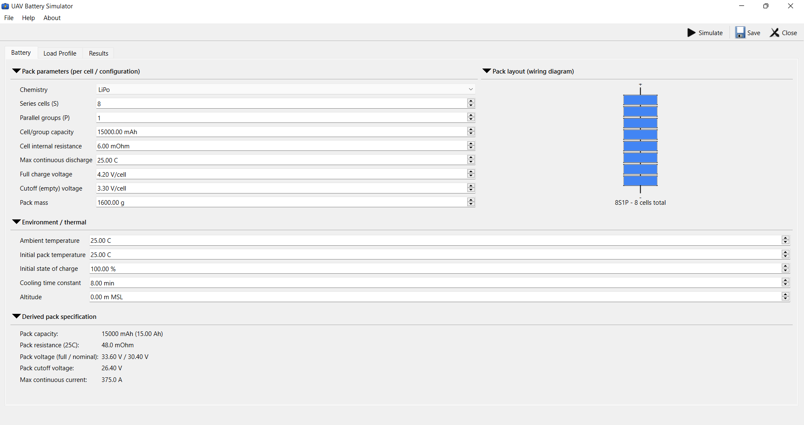
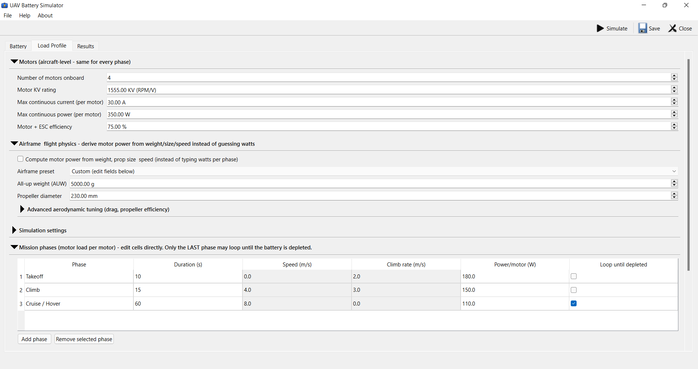
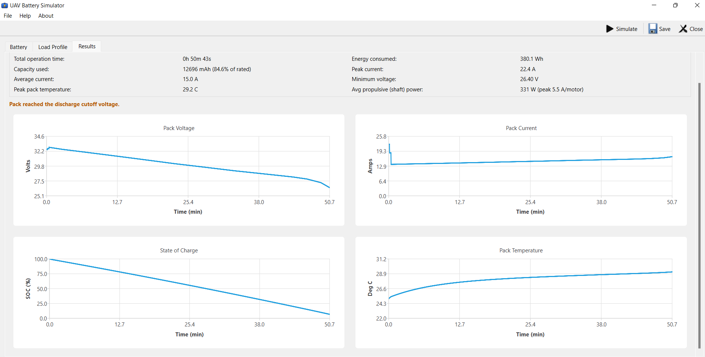

# UAV Battery Simulator

-0078D6)

A free Windows app that simulates how a LiPo/Li-ion battery pack actually
performs on a drone — built for hobbyists and professionals alike.

## Why

`mAh ÷ current draw` is the estimate most people use for flight time, and
it's wrong in predictable ways — it ignores voltage sag under load, how a
pack heats up and loses usable capacity as it discharges, and how much power
your specific airframe actually needs to fly. This tool models all of that,
so you get a realistic number instead of a rule of thumb.

## Screenshots

**Battery setup** — cell-level specs, with a live pack wiring diagram:

**Load profile** — motors, optional physics-based power estimation, and
mission phases:

**Results** — endurance, energy used, and live voltage/current/SOC/temperature
charts:

## What it does

- **Physics-based discharge model** — voltage, internal resistance and
  usable capacity all respond realistically to load, temperature and state
  of charge, instead of assuming a flat battery.
- **Thermal simulation** — tracks pack temperature rise under load and its
  effect on performance.
- **Motor power from real physics (optional)** — instead of guessing a
  wattage, derive it from your aircraft's weight, propeller size, speed and
  climb rate, with presets for common builds (tiny whoop through industrial
  multirotor).
- **Mission profiles** — model takeoff, climb, cruise, hover, with
  always-on electronics (flight controller, GPS, video, etc.) drawing power
  alongside the motors.
- **Clear results** — estimated flight time, energy used, peak current,
  pack temperature, and live charts, plus CSV export for your own analysis.
- **Save/load your setups**, so you can compare different packs or aircraft
  configurations.

<b>How it works (technical details)</b>

- **Battery model**: a Thevenin equivalent circuit (open-circuit voltage in
  series with internal resistance), with OCV as a function of state of
  charge, chemistry-specific curves for LiPo vs. Li-ion, and internal
  resistance that rises at low temperature. Usable capacity is derated by
  both temperature and discharge rate (Peukert exponent).
- **Thermal model**: a lumped thermal mass heated by I²R joule losses,
  cooling toward ambient with a configurable time constant.
- **Motor power model**: actuator-disc (momentum) theory — required thrust
  from weight and drag at a given airspeed, power from propeller disc area
  and air density (itself derived from altitude and temperature, so
  hot/high conditions correctly require more power for the same thrust).
- Each timestep solves the pack's power-balance equation for current, so
  voltage sag is physically consistent with the requested load rather than
  assumed constant.

These are engineering approximations intended to give realistic,
physically consistent trends for sizing and flight planning — not
manufacturer-certified runtime predictions.

## Requirements

Windows 10 or 11, 64-bit. No installation, no dependencies — the download
is self-contained.

## Download

Grab the latest version from the [Releases](../../releases) page — unzip
and run `UAVBatterySim.exe`.

This repo hosts downloads only; the source code is maintained privately.

## License

Free to download and use, for personal and professional purposes.
Redistribution of the compiled app is fine; the source is not public and
reverse engineering isn't permitted.

## Feedback

This is actively developed, and feedback shapes what gets worked on next.
Found a bug, have a feature request, or a parameter that doesn't match your
real-world experience? The app has a built-in feedback form (Help → About),
or email aestosone@gmail.com directly.
